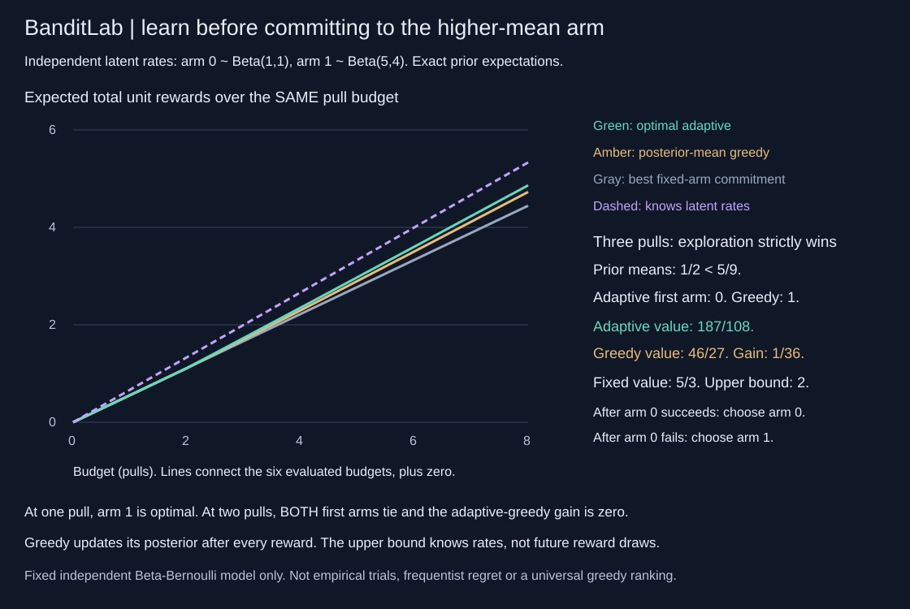
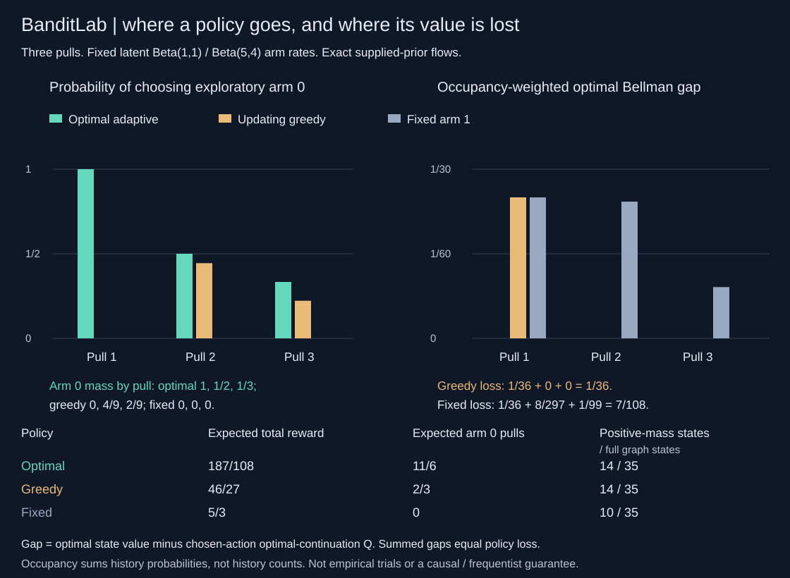

# BanditLab

Exact finite-budget Bayesian bandit planning from scratch. Independent Beta-Bernoulli arms, posterior-state Bellman backups, complete action values and ties, a fully updating greedy baseline, and an exact clairvoyant prior upper bound. Dependency-free Python 3.10+, strict JSON CLI and rational results.



## A lower current mean can be the better first choice

Arm 0 has prior `Beta(1,1)`, mean `1/2`. Arm 1 has prior `Beta(5,4)`, mean `5/9`. Each arm's unknown success rate is drawn **once** from its prior and then stays fixed. Pulling an arm returns a unit Bernoulli reward and updates only that arm's posterior. The objective is expected total reward over the stated finite budget, integrating over both latent rates and reward outcomes.

With one pull, choose arm 1. With two pulls, both first arms tie and the adaptive-greedy gain is zero. With **three pulls**, the optimal adaptive policy starts with arm 0, despite its smaller current mean. If that first pull succeeds, choose arm 0 next; if it fails, choose arm 1 next. The full returned state graph determines the last action too.

| Same three-pull budget | Exact prior expected total reward |
|---|---:|
| Optimal adaptive policy | 187/108 |
| Posterior-mean greedy policy | 46/27 |
| Best fixed-arm commitment | 5/3 |
| Knows the latent rates beforehand | 2 (upper bound) |

The adaptive gain over greedy is exactly `1/36`. Greedy is **not frozen**: it updates its posterior after every outcome and picks a new highest-mean arm at every remaining decision. The fixed baseline maximizes over all fixed action sequences implicitly: without using outcomes, every pull should go to an arm with the best prior mean. The clairvoyant comparator has extra parameter information and is not an available learning algorithm. It knows the rates, not future realized reward draws.

These are prescribed, exact supplied-prior examples, not simulated trials, development/test accuracy, confidence intervals or a universal empirical ranking of bandit algorithms. The six evaluated budgets are 1, 2, 3, 4, 6 and 8; the SVG's lines connect those values plus the known zero-budget origin.

```sh
python -m banditlab demo
python -m banditlab solve examples/two-arms.json
python -m unittest discover -s tests -v
PYTHONPATH=. python examples/render_audit.py --check
python -m pip install .
banditlab demo
```

## Follow a policy forward and account for every lost reward



`audit_policy` evaluates `optimal`, `greedy`, `fixed`, or a complete randomized policy kernel on the solver's information-state IDs. It propagates exact probability mass forward, separately from the backward conditional policy values. Every state reports occupancy, action probabilities, reward contribution, all action/outcome flows, the optimal Bellman gap, and its occupancy-weighted contribution. Every pull reports arm-choice probabilities, success/failure masses and expected reward. Terminal mass is one, including at horizon zero.

For the three-pull example:

| Policy | Expected arm 0 pulls | Positive-mass states / full graph | Exact loss versus optimum |
|---|---:|---:|---:|
| Optimal adaptive | 11/6 | 14/35 | 0 |
| Updating greedy | 2/3 | 14/35 | 1/36 |
| Fixed arm 1 | 0 | 10/35 | 7/108 |

The greedy policy's entire `1/36` loss is its first-decision optimal Bellman gap; its later occupied decisions have zero gap. The fixed policy's contributions are `1/36`, `8/297` and `1/99`, which sum to `7/108`. This is a finite-horizon performance-difference identity, **not a causal experiment**. Each gap compares the current randomized action to optimal continuation, rather than using that policy's continuation value. Telescoping over its own occupancy gives `optimal_value - expected_reward = sum(weighted_optimal_bellman_gap)`. Total clairvoyant Bayes regret also equals optimal Bayes regret plus this policy loss.

```python
from banditlab import solve, audit_policy

report = audit_policy([[1, 1], [5, 4]], horizon=3, policy="greedy")
assert report["expected_reward"] == [46, 27]
assert report["policy_loss"] == report["weighted_bellman_gap_sum"] == [1, 36]

# State IDs come from the same priors, horizon and solver version.
plan = solve([[1, 1], [5, 4]], horizon=3)
kernel = [[[1, 3], [2, 3]] if n["remaining"] else [] for n in plan["states"]]
mixed = audit_policy(plan["priors"], horizon=3, policy=kernel)
assert mixed["terminal_probability_mass"] == [1, 1]
```

A custom policy is a list indexed by **every** returned state ID: each decision row has K rational `[numerator,positive_denominator]` probabilities summing exactly to one, and each terminal row is `[]`. Entries must be exact non-boolean integers with numerator 0..1,000,000 and denominator 1..1,000,000. Unreachable rows are still required and validated. Randomization is independent conditional on the current information state; hidden private memory, correlated coins across time and arbitrary history-dependent policy input are not supported. Named policies choose the first index in a tie; `fixed` commits to the best **initial** mean arm. Zero occupancy does not erase a state's conditional value. Occupancy is summed history probability, not a count of histories or the posterior probability of an unknown environment.

```sh
python -m banditlab policy-demo
python -m banditlab audit examples/policy.json
PYTHONPATH=. python examples/render_policy_audit.py --check
```

The audit CLI uses exactly `version`, `priors`, `horizon`, and `policy`; it shares the strict JSON, size and state-budget rules of `solve`. It builds one solution and refuses before solving if the state preflight fails. Its complete result and full zero-mass-state details are compressed into the second SVG's metadata with the same lossless format described below.

## Exact learning-state planning, not a sampled rollout

For arm `i`, a posterior `Beta(alpha_i,beta_i)` predicts success probability `p_i=alpha_i/(alpha_i+beta_i)`. A success increments alpha; a failure increments beta. Other arms do not change. The finite-horizon recursion is:

```text
V(0, posterior) = 0
Q(h, posterior, i) = p_i * (1 + V(h-1, posterior_after_success_i))
                  + (1-p_i) * V(h-1, posterior_after_failure_i)
V(h, posterior) = max_i Q(h, posterior, i)
```

The implementation builds every reachable posterior/time state bottom-up, merges histories with identical sufficient counts, and returns the entire graph. Every state records posterior parameters/means, remaining budget, optimal Q-values, **all maximizing arms**, selected first-index tie, greedy action, all forced-first-action/greedy-continuation values, greedy total value, best fixed-arm value, and both outcome probabilities/child IDs for every arm. Terminal states have zero value, no action and no outgoing branches. At budget zero, root action and arm tie lists are empty.

The state table covers states reachable under **any** action/outcome history. It is not a list of states visited by the selected policy, an occupancy distribution, a simulated transcript or the full unmerged policy-tree count. Child IDs precede parent IDs; `root_state_id` identifies the last record. Exact fractions serialize as `[numerator,positive_denominator]`.

```python
from banditlab import solve
result = solve([[1,1], [5,4]], horizon=3)
assert result['optimal_actions'] == [0]
assert result['greedy_first_action'] == 1
assert result['adaptive_gain_over_greedy'] == [1,36]
root = result['states'][result['root_state_id']]
```

## An exact information-advantaged upper bound

For independent latent arm rates with CDFs `F_i`, the maximum rate has CDF `product_i F_i(x)`. Integer Beta shapes make each CDF a finite rational polynomial. BanditLab integrates it exactly:

```text
E[max_i theta_i] = integral_0^1 (1 - product_i F_i(x)) dx
clairvoyant expected reward = horizon * E[max_i theta_i]
Bayes regret = clairvoyant expected reward - policy prior expected reward
```

The output includes the product-CDF polynomial in increasing-power coefficient order, exact best-rate expectation, reward upper bound and Bayes regret for optimal, greedy and fixed policies. These are expectations under the supplied independent prior, not realized regret after one outcome sequence, a fixed-environment frequentist regret guarantee, a confidence bound or access to future reward noise. With one arm, all policies match and Bayes regret is zero. In the demo, `E[max(theta_0,theta_1)]=2/3`; at three pulls the optimal Bayes regret is `29/108`.

## Strict inputs and exact state preflight

CLI input has exactly `{"version":1,"priors":[[alpha,beta],...],"horizon":integer}`. Priors must contain 1..3 arms. Every initial alpha/beta is an integer in 1..16. Horizon is an integer in 0..12. Floats, booleans, strings, malformed shapes, unknown/duplicate keys and invalid ranges are rejected. CLI files are capped at 64 KiB. Internal posterior parameters may grow beyond 16; the limit applies to supplied starting parameters.

For K arms and horizon H, there are exactly `binomial(H+2*K,2*K)` posterior/time states reachable under some action history. Success/failure increments are weak compositions of each elapsed budget across 2*K categories. `state_limit` defaults to 4,096 and may be set to 1..20,000. The full exact count is checked **before state generation or polynomial integration**. Refusal returns no partial plan. Two arms at horizon 12 need 1,820 states; three arms at horizon 8 need 3,003. Three arms at horizon 12 need 18,564 and exceed the default limit. There are `2*K*decision_states` directed action/outcome edges.

These counts do not bound Fraction bit lengths, serialized bytes, arithmetic operations, wall time or RAM. No random seed, network, paid API, model download, GPU or dataset is needed. A six-module wheel runs outside the source checkout and reproduces the demo exactly.

## Independent checks

34 tests include:

- Every complete depth-three two-arm policy tree for 16 prior pairs: **2,048 policy references**. An independent oracle enumerates binary outcome strings, follows the tree and integrates each arm's latent rate using Beta-function factorial moments, rather than the production posterior recurrence. It checks all root Q-values/ties, the optimum and the fully updating greedy policy.
- Every complete depth-two three-arm policy tree for 64 prior triples: **1,728 references**, including root values and ties. A separate audit reconstructs every state, outcome edge, posterior update, Q-value, optimal tie and greedy continuation in a 462-state three-arm graph.
- Exact state/edge counts at 1,820 and 3,003 states; refusal before generation/integration; horizon zero/one, full ties, single-arm identities, prior persistence, malformed inputs, strict CLI and input/output/RNG isolation.
- All 256 initial Beta shape pairs checked against an independent binomial/Bernstein CDF expression at stated rational points and exact first moments. The maximum-rate integral is separately computed by multiplying Bernstein terms and integrating Beta moments, including the high-shape three-arm case. No production monomial expansion is used by this integral oracle.
- Four SVG tests check all 28 shared-scale vertices, full compressed metadata, regeneration and rejection of changed undisplayed terminal/CDF data.

- Eleven policy-audit tests add 144 independent named-policy history references across 16 prior pairs and three horizons. Joint action/outcome-prefix enumeration integrates latent Beta moments directly, not production edges or predictive probabilities. Two- and three-arm randomized kernels get separate joint-history checks. Every flow, conditional value, gap, probability conservation and regret decomposition is checked, with zero-mass, horizon-zero, tie, malformed-kernel, CLI, preflight and isolation cases.
- Four more SVG tests check all 18 bars and both metric scales, complete audit metadata, regeneration and rejection of an undisplayed zero-mass conditional-value change.

## Attribution and limits

The Bayesian information-state formulation, Beta-Bernoulli predictive mean, Bellman objective and parameter-informed comparison follow [Min, Maglaras and Moallemi, *Thompson Sampling with Information Relaxation Penalties*, Sections 2 and 3](https://ar5iv.labs.arxiv.org/html/1902.04251v1). BanditLab implements the small full finite-state Bellman problem, **not that paper's IRS algorithms**, Thompson sampling, Gittins indices or a large-scale bandit method. The exact state enumerator, schema, CDF integration, code, independent oracles, fixtures and figure are original; no external code or dataset is copied. [DESIGN.md](DESIGN.md) gives the derivations. MIT licensed.

The guarantee depends on correct independent stationary Beta priors and conditionally IID unit Bernoulli rewards. No correlated arms, changing rates, contextual features, costs, delayed feedback, continuous rewards, infinite horizon, empirical confidence/coverage or real-world decision-safety claim is made. Exact arithmetic does not make an assumed prior true.
